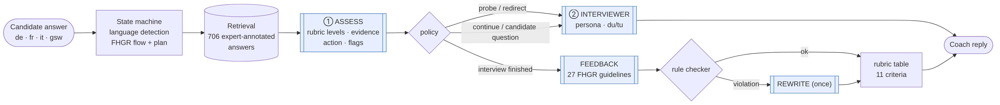

# SmartStart — Apertus Job-Interview Coach

**Hack Apertus 2026 · Track 2A · FHGR challenge "AI-Powered Job Interview Coach"**

SmartStart lets young people in Switzerland (14–16) practise a realistic apprenticeship
interview in **German, French or Italian** (Swiss-German dialect input understood) and
get personal, constructive feedback that follows the FHGR/Profolio rubric (11 criteria)
and the 27 FHGR feedback guidelines. It is built on **Apertus 1.5 · 8B**, runs on
consumer hardware (tested on a MacBook Pro M4 Pro, 48 GB unified memory; < 32 GB VRAM)
and uses **≈ 2.1 LLM calls per candidate answer** (limit: < 5).




## Results (Apertus 1.5 8B, details in [technical_report.md](technical_report.md) / `SmartStart_Report.pdf`)

| | Baseline (no retrieval) | **SmartStart** |
|---|---|---|
| Coach-action accuracy vs. FHGR experts (100 answers, de/fr/it/gsw) | 0.44 | **0.83** |
| Quality level within ±1 of expert | 0.97 | **0.99** |
| Distress-signal recall | 0.00 | **1.00** |
| LLM calls per candidate answer (28 scenarios, limit < 5) | – | **2.11** |
| FHGR scenario success criteria met (LLM judge) | – | **100 %** |
| Final build: coach-action accuracy (same 100 answers) | – | **0.80** |
| Final build: feedbacks with guideline violations (6 re-run scenarios) | – | **0 / 6** |
| Final build: LLM calls per answer (6 scenarios) | – | **2.12** |

v1 → final trade-off: action accuracy 0.83 → 0.80, level accuracy 0.65 → 0.57, in exchange for order-verified quotes, gap-targeted follow-ups, negation-safe experience cards and atomic, retry-safe turns (see report §5).

**Learning loops (v2):** gap-targeted follow-ups (one named missing element, never the same gap twice) ·
*No example?* → an **experience card** from school, sport or hobby built only from the student's own
words · *Practise this answer again* with a deterministic before/after rubric comparison ·
*Try a new question* (transfer practice for the weakest criterion) · *Download card* (Markdown practice card).

## How it works (one candidate answer)

| Step | What | LLM? |
|---|---|---|
| 1 | Language / dialect detection (de · fr · it · gsw) | no |
| 2 | Interview state machine: introduction → motivation → strengths/weaknesses → situational → candidate questions → closing → feedback; questions planned for the posting's occupational field and the candidate profile | no |
| 3 | **Retrieval of expert-annotated answers** (706 FHGR annotations) to the same question as calibration anchors | no |
| 4 | **Assess** the answer: rubric levels, verified evidence quote, observed / missing elements, coach action (continue / probe / redirect / support_and_refer), problem flags | **1 call** |
| 5 | Deterministic policy: gap-targeted follow-up (max. 1 per question, 4 per interview, no repeated gap, no politeness gaps) or next question; answer the candidate's own questions from the posting facts | no |
| 6 | **Interviewer turn** in persona (Berufsbildner/in from the posting), du/tu form | **1 call** |
| end | **Final feedback** (strengths → improvements with quotes → next step → encouragement) | 1 call |
| end | **Guideline checker** (T3, B3, L2, L4, K1, R1/R3, S3, S4) → one rewrite only if violated; deterministic tidy-up (3 sections, quotes ≤ 10 words, Swiss ss) | 0–1 call |
| end | Deterministic rubric overview (11 criteria; "no evidence" instead of guessing, K3) | no |

Details: [technical_report.md](technical_report.md) · [docs/architecture.md](docs/architecture.md)

## Run it

### 1. Start Apertus (OpenAI-compatible endpoint)

Any OpenAI-compatible server works; set `LLM_BASE_URL`, `LLM_API_KEY`, `LLM_NAME`.

* **macOS (Apple Silicon), what we used**
  ```bash
  pip install mlx-lm huggingface_hub
  hf download swiss-ai/Apertus-v1.5-8B
  mlx_lm.server --model swiss-ai/Apertus-v1.5-8B --port 8080
  # LLM_BASE_URL=http://host.docker.internal:8080/v1  (default in .env.example)
  ```
* **Linux + NVIDIA GPU**: `make run-gpu` (adds a vLLM container serving Apertus 1.5 8B, < 32 GB VRAM)
* **Hosted endpoint** (CSCS, HF, …): put its URL/key into `.env`.
* **No GPU, smoke test only**: `LLM_BASE_URL=mock`.

### 2. Start the coach

```bash
make run        # docker compose: Aegra API on http://localhost:2026 (graph id "agent") + Postgres + Redis
                # + SmartStart web app on http://localhost:7860
```

**Web app (http://localhost:7860):** choose language (de/fr/it) and an apprenticeship posting, do the
interview, see the coach's live analysis of every answer (rubric levels, evidence quote, next action),
get the final feedback and *practise an answer again* — the improved answer is re-assessed and compared
criterion by criterion. Without Docker: `make ui`.

Talk to it with the [Agent Chat UI](https://github.com/langchain-ai/agent-chat-ui)
(deployment URL `http://localhost:2026`, assistant/graph id `agent`), or via the API.
Optional input fields per thread: `lang`, `posting_id`, `candidate_id`, `scenario_id`,
`dialect` (e.g. `zh` to ask questions in Züritüütsch), `feedback_mode` (`end` | `per_answer`).
Type `/feedback` to end early, `/neu` to restart.

Terminal chat without Docker: `make cli ARGS="--lang fr"` (Python ≥ 3.10, standard library only).

### 3. Tests & evaluation

```bash
make test         # offline unit tests (mock LLM)
make smoke        # all 28 FHGR scenarios end-to-end with the mock LLM
make eval         # assessment accuracy, 28 simulated interviews, LLM-as-judge, report → eval/results/RESULTS.md
```

## Repository layout

```
src/main.py              LangGraph graph served by Aegra (graph id "agent")
src/smartstart/          coach logic: planner, retrieval, prompts, rules, llm client, cli
data/fhgr/               FHGR/Profolio challenge datasets (provided for Hack Apertus)
eval/                    eval_assess.py · simulate.py · judge.py · report.py
tests/                   offline tests
docs/                    architecture diagram, figures
```

Requirements: Docker (for `make run`); an Apertus 1.5 8B endpoint (local weights ≈ 16 GB, < 32 GB VRAM / unified memory); no API keys needed for local serving.

## Team


**ccnewbee** — Chu Jia & Sice Huang (University of Zurich). © 2026 Team ccnewbee.

## Data & licence

Code: Apache-2.0 (see repository root). FHGR/Profolio material in `data/fhgr/` belongs to
FHGR and is provided for use in the Hack Apertus challenge (see `data/fhgr/README.md`);
occupation data © SDBB / berufsberatung.ch.

---

*Challenge info (template):* Submissions must use the Apertus model family. Submit via
http://hackapertus.ch/online-hack/submissions. Getting Started guide:
https://hackapertus.notion.site/getting-started-guide-onlinehack
