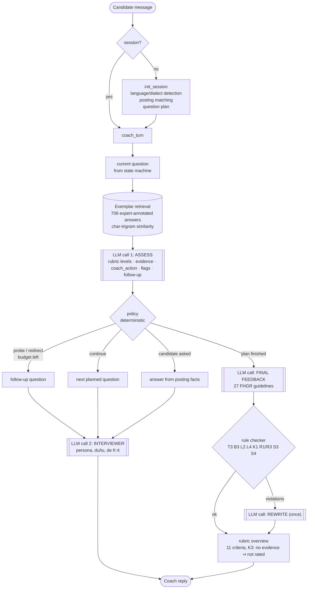

# Architecture

* **Graph** (`src/main.py`): `START → (init_session) → coach_turn → END`; one run per candidate
  message; the whole session (plan, assessments, LLM-call counter) lives in the LangGraph state
  and is persisted per thread by Aegra's Postgres checkpointer.
* **LLM budget**: 2 calls per answer + 1–2 calls for the final feedback ⇒ ≈ 2.1 calls/answer.
* **Where it runs**: Apertus 1.5 8B locally (MLX on Apple Silicon or vLLM on one consumer GPU);
  the coach container only talks to an OpenAI-compatible URL → on-premise, privacy-preserving.
