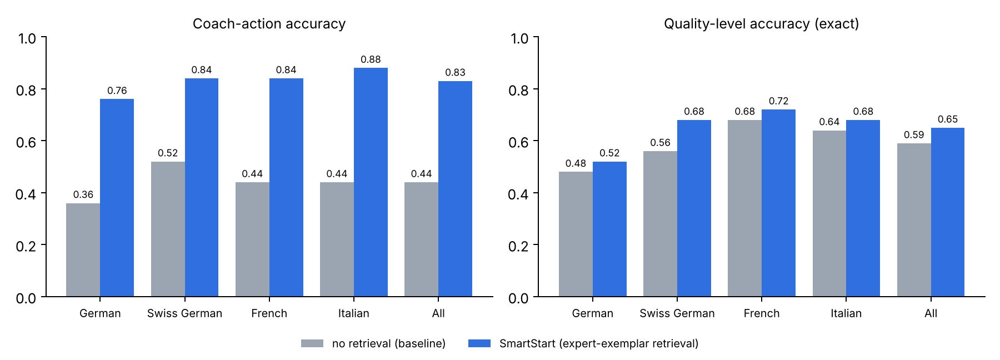
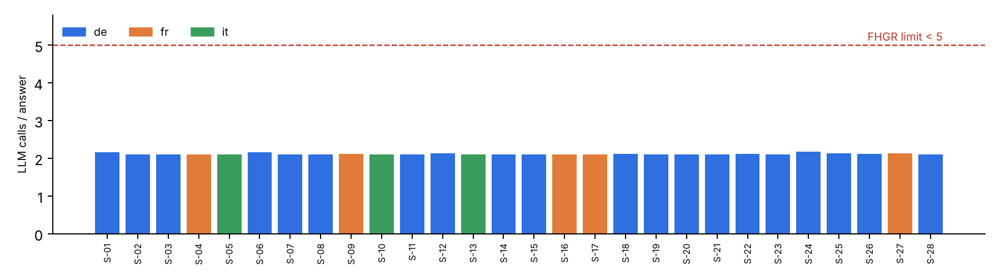

# Technical report — SmartStart: a rubric-grounded Apertus interview coach

- **Track:** Track 2A — FHGR: AI-Powered Job Interview Coach
- **Event:** Online (1–16 October 2026)
- **Team:** ccnewbee — Chu Jia, Sice Huang (University of Zurich); project: SmartStart
- **Demo:** `make run` → web app on `http://localhost:7860` + Aegra API on `http://localhost:2026` (graph `agent`); 2-minute video: see submission

## 1. Summary

Young people preparing for their first apprenticeship interview rarely get repeated, individual
practice. **SmartStart** is an Apertus-1.5-8B interview coach that runs a realistic, adaptive interview
in **German, French or Italian** (Swiss-German dialect input understood) and ends with personal,
guideline-compliant feedback. Instead of one large prompt, SmartStart combines (i) a deterministic
interview state machine that follows the FHGR interview flow, (ii) **retrieval of FHGR FHGR-annotated
answers as calibration anchors**, (iii) a **two-call loop per answer** (assess → interviewer turn) and
(iv) a **rule checker for the FHGR feedback guidelines** that triggers a single rewrite only when needed.

**Headline results, first version v1** (Apertus 1.5 8B, vLLM on one GH200 at CSCS; final-build numbers below):
annotated-exemplar retrieval raises the accuracy of the coach's next-action decision from **0.44 to 0.83**
(100 FHGR-annotated answers, de/fr/it/Swiss German) and detects both distress cases in the sample (recall 1.0 vs. 0.0, n = 2);
quality levels are within ±1 of the reference in **99 %** of cases; all **28 FHGR scenarios** run end-to-end
with **2.11 LLM calls per candidate answer** (limit < 5) and 27/28 final feedbacks pass all automatic
guideline checks.

**The final version (v3)** makes every follow-up *gap-targeted* (the assessor names what is
present and what is missing; the coach asks for exactly one missing element and never for the same gap
twice), keeps an evidence quote only if it occurs *in order* in the answer, and adds three
learning loops for students without work experience: an **experience card** built only from the
student's own words, **transfer practice** on a new question for the weakest criterion, and a
downloadable **practice card**. Everything the student reads about *their own* answers is grounded by
construction: quotes, experience-card facts and progress verdicts are checked against the student's words
or the rubric, never taken from the model on trust, and a negation or number flip («ich habe das Team
*nicht* geleitet» → "led the team") is rejected. Every turn is atomic, so a model timeout never skips a
question or logs an answer twice. On the frozen 100-answer set the final build keeps action accuracy at
**0.80** with JSON/schema validity 0.99; 6 re-run scenarios produce **0/6** guideline violations at **2.12
calls per answer**; the cost is lower level accuracy than v1 (0.57 vs. 0.65, see §5). **Resources:** the
whole vLLM process peaks at **25.8 GiB GPU memory** (nvidia-smi, < 32 GB limit) with identical accuracy.
**Consistency:** the same 15 answers in de/fr/it get the same follow-up decision in 87–93 % of cases and
a level within ±1 in 100 %; repeated runs are 100 % identical.

## 2. Architecture

| Component | File | LLM calls |
|---|---|---|
| LangGraph graph served by Aegra (`agent`, port 2026); session state persisted per thread in PostgreSQL, Redis job queue | `src/main.py`, `docker-compose.yml` | – |
| Language & dialect detection (stop-word / Mundart-marker heuristic) | `smartstart/langdetect.py` | 0 |
| Interview planner: FHGR flow introduction → motivation → strengths/weaknesses → situational → candidate questions → closing; occupation-specific questions via the posting's `berufsfeld`; conditional questions (Stellwerk, absences) only if the profile justifies them; FHGR scenario plans; free-text occupation wish matched to a posting | `smartstart/planner.py` | 0 |
| **Exemplar retrieval** over 706 FHGR-annotated answers (char-trigram Jaccard — robust across de/fr/it and dialect spelling; same question first; diverse quality levels; leave-one-out in evaluation) | `smartstart/retrieval.py` | 0 |
| **Assess**: JSON with rubric levels (1–4 / null), evidence quote, strength, improvement, coach action (`continue / probe / redirect / support_and_refer`), problem flags, **observed / missing elements and one follow-up target**, follow-up, coaching tip; one JSON retry; the quote is kept only if it is found in the answer (normalised substring or ≥ 90 % token overlap) | `smartstart/coach.py` | **1 per answer** |
| Deterministic policy: ≤ 1 follow-up per question, ≤ 4 per interview; the same gap is never asked twice; nothing missing and level ≥ 3 ⇒ continue instead of probing; politeness gaps (greeting, thanks, invitation) are filtered out, so follow-ups always target substance; candidate questions answered only from posting facts; explicit distress signal ⇒ supportive mode with referral to a real person (L3) | `smartstart/coach.py` | 0 |
| **Interviewer** turn in the persona of the posting's Berufsbildner/in, du/tu form | `smartstart/coach.py` | **1 per answer** |
| **Final feedback** (strengths → max. 3 improvements, each with a short quote → one next step → encouragement) | `smartstart/coach.py` | 1 per interview |
| **Guideline checker** T3, B3, L2, L4, K1, R1/R3, S3, S4 ⇒ **rewrite once** only if violated; then a deterministic tidy-up keeps only the three FHGR sections, cuts quotes to ≤ 10 words and enforces Swiss spelling (ss) in all German output | `smartstart/rules.py`, `coach.py` | 0–1 per interview |
| Deterministic rubric table for all 11 FHGR criteria; "no evidence" instead of guessing (K3) | `smartstart/coach.py` | 0 |
| **Experience card** ("No example?"): a guiding prompt about school, sport, hobby or family → situation / own action / result, each field checked separately against the student's words — the fact text must be backed by its own verified quote or almost word-for-word by the story, with the strictest test for the *result*, where models invent most; unstated results shown as "not yet stated"; the drafted answer falls back to the student's own story if it adds anything; editable, confirmed by the student | `smartstart/coach.py` | 1 per card |
| **Transfer practice**: an unused question from the student's own occupational field for the weakest criterion; the new answer is compared with the earlier level (first evidence / higher / same / lower) | `smartstart/coach.py` | 1 per answer |
| **Practice card** (Markdown download): confirmed experience card, strongest criterion with a verified quote, weakest criterion with its gap, next step, next practice question | `smartstart/coach.py` | 0 |
| **Robustness:** each turn is a transaction (snapshot → model calls → commit; restored on any failure) with a client `turn_id` so a retried request returns the same result; assessment JSON decoded with a real JSON decoder and schema-checked (`schema_ok`) — unusable output keeps the student on the same question; a failed closing line falls back to a fixed sentence and never blocks the feedback | `smartstart/coach.py`, `llm.py`, `webui.py` | 0 |

**Web app** (`src/smartstart/webui.py`, standard library only): the candidate picks a language and a
posting and does the interview; a side panel shows the coach's live analysis of every answer (rubric
levels, evidence quote, next action, flags). After the feedback, any answer can be **practised again**: the
improved answer is re-assessed (1 call) and compared criterion by criterion — the comparison is
deterministic, so the coach cannot claim progress the rubric does not show.
Every answer card shows what the coach saw (known / missing / what the next question aims at) and marks
the evidence quote as verified. *No example?* opens the experience card; *Try a new question* starts
transfer practice; *Download card* exports the practice card.

Two feedback modes: `end` (realistic interview, feedback at the end — default) and `per_answer`
(adds the assessment's one-line tip after each answer, at no extra LLM cost).

**What is new.** (1) The FHGR annotations are used *at inference time* as few-shot calibration anchors
selected per question and per answer — no fine-tuning, yet the coach inherits the annotators' judgement of
when to probe. (2) Control flow is deterministic and only language generation is delegated to the LLM,
which keeps the call budget fixed (2 per answer) and behaviour reproducible. (3) The FHGR feedback
guidelines are enforced twice: in the prompt and by a lexical checker that triggers a targeted rewrite.
(4) **Grounding by construction:** the model may phrase, but it may not assert facts about the student.
Evidence quotes are verified against the answer, experience-card facts against the story, and
"practise again" progress is a deterministic rubric comparison — so the coach cannot praise words the
student never said or invent a result for a student without work experience.

## 3. Use of Apertus

- **Model:** `swiss-ai/Apertus-v1.5-8B` (bf16), the only generative model in the system.
- **How it is used:** inference — structured assessment (JSON), interviewer role-play, feedback
  generation and rewrite. In the evaluation Apertus also plays the candidate and acts as judge (§5).
- **Where it runs:** vLLM, official image `ghcr.io/swiss-ai/vllm_apertus_1.5_release` (arm64),
  one NVIDIA GH200 node on CSCS Clariden (project g238); OpenAI-compatible API reached through an SSH
  tunnel. The coach only needs `LLM_BASE_URL / LLM_API_KEY / LLM_NAME`, so it runs unchanged against any
  on-premise endpoint (`docker compose --profile gpu` starts vLLM on a single consumer GPU, 8B bf16 ≈ 16 GB).
  **Measured memory:** with `--gpu-memory-utilization 0.22 --max-model-len 8192` the complete vLLM process
  (weights, KV cache, CUDA graphs, vision encoder) peaks at **26 395 MiB = 25.8 GiB** on GPU 0 during the full
  E1 run (nvidia-smi every 5 s; `scripts/cscs/serve_apertus.sbatch`). E1 under this limit gives the same
  scores as with the default setting (action 0.80, level 0.57, ±1 0.98): the setting only shrinks the KV
  cache, not the model. The longest prompt (final feedback) is ≈ 5 k tokens, well inside 8 192.
  Note: in October 2026 Apertus 1.5 is not yet supported by released MLX / transformers versions; on a
  MacBook (M4 Pro) the swiss-ai transformers branch loaded the model but MPS bf16 produced corrupted text
  and fp32 exceeded memory, which is why we served it with vLLM.
- **Prompts:** `src/smartstart/prompts.py`. Instructions in English, all user-facing text in the
  interview language; temperature 0 for assessment, 0.3–0.4 for generation; fixed seed 42.
  Every request is a single system + user message (the Apertus 1.5 vLLM chat template rejects replayed
  multi-turn assistant messages, so dialogue history is passed as text).

## 4. Data

Only the FHGR/Profolio challenge data (provided for Hack Apertus; `data/fhgr/`, 2.6 MB): 242 questions
(+ Swiss-German variants), 706 answers at 4 quality levels in de/fr/it and 8 dialects with expert
annotations, the 11-criterion rubric, 27 feedback guidelines, 24 candidate profiles, 30 postings,
28 scenarios with coach success criteria, 30 good-vs-poor feedback pairs. All records are synthetic or
didactic; no personal data. No other data was used and no model was trained.

## 5. Evaluation

The official LLM-as-judge benchmark is hidden, so we built three proxy experiments
(`make eval`; raw results in `eval/results/`).

**E1 — Assessment vs. FHGR reference annotations.** 100 annotated answers (25 each: de, fr, it, Swiss German;
stratified by quality level). Leave-one-out: an answer's own annotation is never retrieved.

| Setup | Level acc | ±1 acc | Level MAE | **Action acc** | Follow-up acc | Criteria MAE | Distress recall |
|---|---|---|---|---|---|---|---|
| Baseline (rubric only, no retrieval) | 0.59 | 0.97 | 0.45 | 0.44 | 0.79 | 0.54 | 0.00 |
| **SmartStart v1 (annotated-exemplar retrieval)** | **0.65** | **0.99** | **0.36** | **0.83** | **0.87** | **0.46** | **1.00** |
| SmartStart v2 (+ gap-targeted follow-ups, verified quotes) | 0.57 | 0.98 | 0.47 | 0.81 | 0.84 | 0.50 | 0.50 |
| **SmartStart v3 = final** (+ ordered quotes, schema check, atomic turns) | 0.57 | 0.98 | 0.47 | 0.80 | 0.84 | 0.50 | 0.50 |

Retrieval helps in every language group; the largest effect is on *what to do next* (action accuracy
+0.39), which is exactly the decision that makes an interview adaptive. Per language (ours):
action accuracy de 0.76, Swiss German 0.84, fr 0.84, it 0.88; level MAE 0.28–0.48.

**v1 → v2.** The longer v2 JSON (observed / missing / target) keeps the action decision nearly
unchanged (0.81) and makes every evidence quote verifiable (quote verified rate **1.00**, JSON parse
rate 0.99), but level accuracy drops by 0.08 (German 0.40) and one of the two distress cases is
classified as *redirect* instead of *support_and_refer* (recall 0.50, n = 2). We report this trade-off
openly; separating level scoring from gap extraction is the obvious fix (§8).

**v2 → v3 (final build, same 100 answers, same model and seeds).** The robustness changes leave the
scores essentially unchanged (action 0.81 → 0.80; level, ±1, MAE and follow-up accuracy identical) —
i.e. the safety fixes cost nothing measurable. The stricter, order-sensitive quote check now rejects 3
paraphrased "quotes" that v2 accepted (quote verified rate 0.97; those quotes are not shown to the
student). Per language: action accuracy de 0.72, Swiss German 0.80, fr 0.80, it 0.88.

**E2 — 28 simulated interviews.** Apertus plays each FHGR scenario candidate (profile, persona,
dialect where expected) until the coach's final feedback. All 28 runs completed: 511 candidate answers,
47 adaptive follow-ups, **2.11 LLM calls per answer** (max. 2.17 in any scenario; FHGR limit < 5).
The guideline checker flagged 2/28 feedbacks before rewrite and 1/28 after.

**Re-runs on the same 6 scenarios** (de/fr/it, all difficulty levels): v2 — 110 answers, 2.13 calls per
answer, 11 follow-ups, 0/6 violations; **v3 (final)** — 111 answers, **2.12 calls per answer** (max. 2.14),
15 follow-ups (cap: 4 per interview), each aimed at one named gap and **no gap asked twice**; evidence
quotes verified in 106/111 answers under the stricter check; **0/6** feedbacks violate a guideline
(v1 on the same scenarios: 1/6, also after rewrite).

**Live check of the final build** (web app, real Apertus endpoint, 16 Oct): in a French session the
model drafted the result «le joueur a compris les exercices» for a story that states no result; the
grounding check removed it and the card showed *pas encore précisé*, while a story that does state a
result («On a gagné 200 francs») kept it. Politeness answers («danke für die Einladung») no longer
trigger a follow-up, and the final German feedback contained only the three FHGR sections with quotes
≤ 10 words and 0 checker violations. Each coach turn took 2–4 s.

**E3 — LLM-as-judge.** The judge (Apertus 1.5 8B, temperature 0) is first validated on the 30 FHGR
good-vs-poor feedback pairs: it ranks the good feedback higher in **0.90** of 29 valid pairs. On the
transcripts it marks **100 %** of the scenario success criteria as met and rates realism, adaptivity,
relevance, appropriateness and feedback quality **4.96/5** on average (easy 5.0, medium 5.0, hard 4.8;
de 4.95, fr 5.0, it 5.0; language consistency 5.0).

**E4 — Consistency (FHGR: 25 %).** 15 German FHGR-annotated answers (stratified by level) are
translated by Apertus into French and Italian with content and weaknesses kept, then assessed in all three
languages, each twice (`eval/eval_consistency.py`).

| | de | fr | it |
|---|---|---|---|
| Action accuracy vs. reference | 0.80 | 0.87 | 0.80 |
| Same follow-up decision as German | – | 0.93 | 0.87 |
| Same level as German / within ±1 | – | 0.80 / 1.00 | 0.67 / 1.00 |

The follow-up decision differs by at most **6.7 points** between languages for the *same content*, and
levels never move by more than one step. All 45 repeated assessments returned the identical level and
action (temperature 0). On the native 100-answer set the gap is larger (action 0.72 de – 0.88 it), which
points to differences between the language sub-sets rather than to language bias of the coach. Results are
also stable across difficulty levels and situations (judge 4.8–5.0).

## 6. Limitations

- **Judge ceiling / self-preference:** E3 uses the same model family as the coach and saturates near
  5/5; its comments sometimes evaluate the candidate rather than the coach. We therefore treat E1
  (agreement with the FHGR reference annotations, which are synthetic and not yet expert-reviewed) as the primary evidence and E3 as a sanity check.
- German quality-level accuracy is the lowest group (v1 0.52, v2/v3 0.40); most errors are 3-vs-4 on strong
  answers. v2/v3 distress recall is 0.50 on only two test cases: the French case is flagged (which switches
  the app to supportive mode), the Italian one is read as badmouthing — this needs a larger test set.
- The follow-up target is chosen by the model; formalities are now filtered out, but the choice among
  substantive gaps is not yet validated against the experts' follow-up questions.
- Transfer practice is assessed by the same model; in a live check an off-topic answer to the new
  question was still rated level 3, so the transfer verdict is indicative, not a grade.
- Grounding checks are lexical: negations and changed numbers are caught, a role reversal ("Paul
  helped me" → "I helped Paul") is not. The card therefore stays a *draft* until the student confirms it,
  and an edited fact loses its source mark.
- Follow-up targets are sometimes produced in English inside a French or German session (they steer the
  question, which is always generated in the interview language, but show in the analysis panel), and
  some politeness gaps in Italian still pass the filter.
- The feedback occasionally quotes the interviewer's question instead of the student's words; the
  checker does not yet distinguish who said a quote.
- Simulated candidates are more articulate than real 15-year-olds; the FHGR data is synthetic and not
  yet expert-reviewed. No user study yet.
- Text only. The rule checker is lexical; it catches clear violations, not subtle tone problems.
- Dialect is understood on input; output is Standard German (guideline S4).

## 7. Reproducibility

- `make test` — 22 offline unit tests (mock LLM), incl. quote verification, negation/number flips, no
  repeated gap, fact-card grounding (an invented result is dropped), stale draft after editing, a
  simulated timeout mid-turn (state restored, retry logged once), malformed model JSON, formality filter
  and feedback tidy-up; `make smoke` — all 28 scenarios with the mock LLM.
- `make run` — Docker: web app (7860) + Aegra API (2026) + PostgreSQL + Redis; Apertus via `LLM_BASE_URL`
  (`make run-gpu` adds a vLLM container on an NVIDIA GPU).
- `make eval` — E1–E3 + `eval/results/RESULTS.md` (needs an Apertus endpoint). Final-build results:
  `eval/results_v3/` (v2: `eval/results_v2/`).
- CSCS: `scripts/cscs/apertus-vllm.toml` + `serve_apertus.sbatch` reproduce our serving setup.
- Hardware: 1× GH200 (CSCS Clariden) for the model; client on a MacBook Pro M4 Pro.
  Seeds: `LLM_SEED=42`, sampling seed 13. Runtime: E1 ≈ 4 min, E2 ≈ 45 min, E3 ≈ 5 min.

## 8. Next steps

- **Speech:** Apertus 1.5 already accepts audio input, so spoken answers can be assessed directly;
  short plain-text coach turns are ready for a TTS voice (e.g. Piper) and a Swiss-German ASR fallback.
- A teacher dashboard over the per-session rubric levels stored in PostgreSQL.
- Split v2 assessment into a short scoring call and a gap-extraction call to recover v1 level accuracy
  within the < 5 call budget.
- LoRA-tuning the assessor on expert-reviewed annotations; a study with real classes; an independent judge.

## License

Code Apache-2.0; report CC-BY-4.0. FHGR data under the FHGR / Hack Apertus conditions.

## AI assistance

Parts of the code and documentation were drafted with the help of an AI assistant (Claude) and
reviewed, run and evaluated by the team.

## References

- FHGR / Profolio: *Feedbackkriterien zum Vorstellungsgespräch* and challenge datasets, github.com/fhgr/Hackapertus.
- Swiss AI Initiative: Apertus 1.5 model card, huggingface.co/swiss-ai/Apertus-v1.5-8B.
- Kwon et al. (2023): Efficient memory management for LLM serving with PagedAttention (vLLM).
